# Productos de la ficha de Google: listos para cargar

Cada producto tiene su imagen, nombre, categoría, descripción y enlace. Se copian tal cual.

## Cómo se carga cada uno

1. Entrá a la ficha (buscá **Centro Sinapsis** en Google con la sesión de sinapsisdatos@gmail.com, o en business.google.com).
2. Tocá **Editar productos** (en el celular: **Editar perfil → Productos**) → **Agregar producto**.
3. **Foto:** subí la imagen del producto (están en `google-perfil/productos/`).
4. **Nombre del producto:** copiá el nombre (máximo 58 caracteres).
5. **Categoría del producto:** la primera vez escribila; después elegila de la lista. Se usan solo 5: *Autismo y discapacidad*, *Evaluaciones*, *Terapias*, *Adultos mayores* y *Talleres*.
6. **Precio:** dejalo **vacío**.
7. **Descripción:** copiá la descripción (máximo 1000 caracteres; todas tienen menos de 850).
8. **Botón:** elegí **Más información** y pegá el enlace.
9. **Guardar.** Google puede tardar hasta un par de días en revisarlo y mostrarlo.

**Orden de carga:** cargalos del último (Talleres) al primero (Autismo). Google suele mostrar primero los más recientes, así arriba quedan Autismo, ADOS-2 y CUD, que son las búsquedas con más intención de consulta.

**Si Google rechaza uno:** casi siempre es por una palabra de la descripción. Pasame el nombre del producto y lo reescribo.

---

## 1. Autismo (TEA): evaluación y terapias

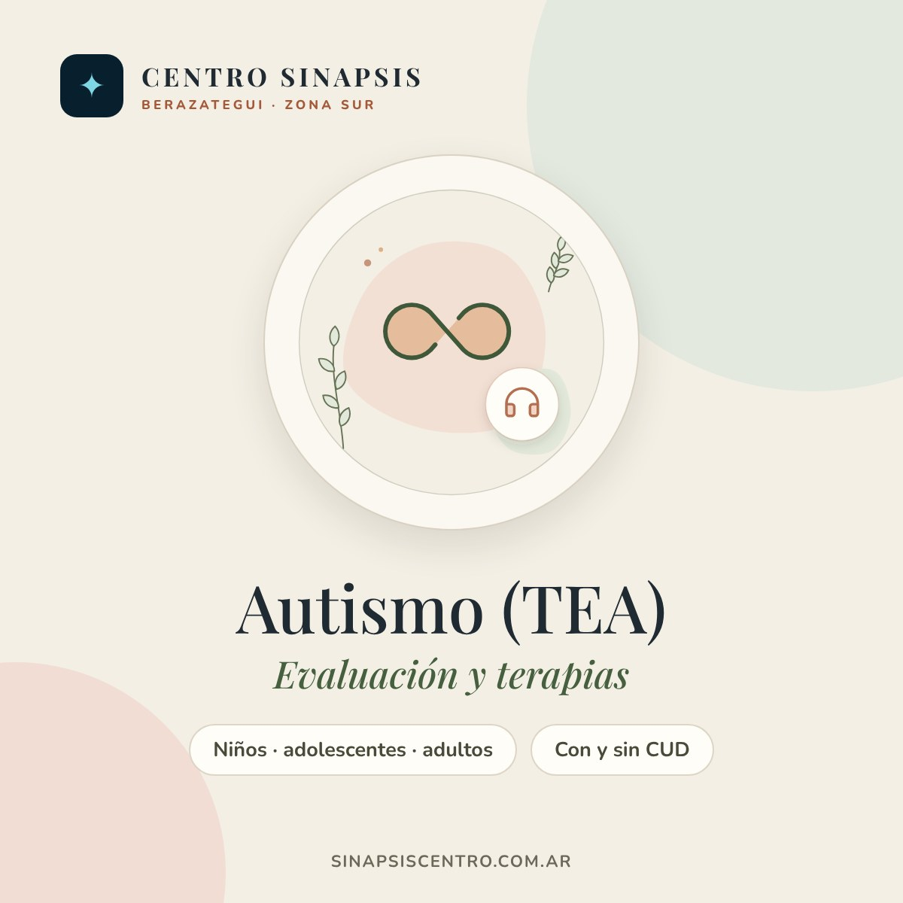

**Imagen:** `google-perfil/productos/01-autismo-tea.jpg`

**Nombre:**

```
Autismo (TEA): evaluación y terapias
```

**Categoría:** Autismo y discapacidad

**Descripción:**

```
Acompañamos a niños, adolescentes y adultos con autismo (TEA) y a sus familias, en Berazategui y toda la Zona Sur.

Evaluación: ADOS-2 y ADI-R, como parte de una evaluación clínica integral.

Tratamiento interdisciplinario: fonoaudiología, terapia ocupacional e integración sensorial, psicología, psicopedagogía y estimulación temprana, con orientación a la familia y articulación con la escuela.

También recibimos a adolescentes y adultos que se preguntan por primera vez si el autismo podría explicar dificultades de toda la vida.

Atendemos con y sin CUD. No hace falta derivación médica: escribinos por WhatsApp y coordinamos la primera entrevista.
```

**Botón:** Más información

**Enlace:**

```
https://sinapsiscentro.com.ar/autismo-tea-berazategui.html?utm_source=google&utm_medium=organic&utm_campaign=gbp
```

---

## 2. Evaluación ADOS-2 y ADI-R

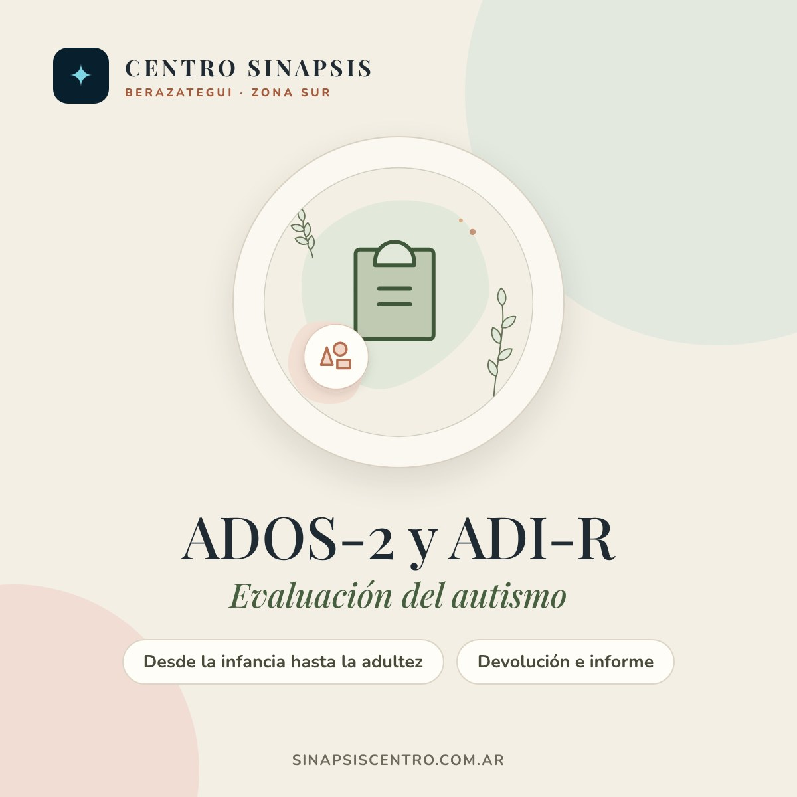

**Imagen:** `google-perfil/productos/02-ados-2-adi-r.jpg`

**Nombre:**

```
Evaluación ADOS-2 y ADI-R
```

**Categoría:** Evaluaciones

**Descripción:**

```
El ADOS-2 es una serie de actividades guiadas: el profesional juega, conversa e interactúa con la persona para observar su comunicación, su interacción social y su conducta. El ADI-R es una entrevista a los padres o cuidadores sobre el desarrollo.

Son instrumentos estandarizados que forman parte de una evaluación clínica integral del Trastorno del Espectro Autista (TEA): ningún instrumento diagnostica por sí solo. El ADOS-2 tiene módulos según la edad y el lenguaje, por eso se usa desde la primera infancia hasta la adultez.

Al terminar hay una devolución personalizada y un informe, que puede servir para iniciar el trámite del CUD u organizar apoyos.

Para familias que notan diferencias en la comunicación o el juego, pedidos de la escuela o el pediatra, y adultos que consultan por primera vez. Coordinamos por WhatsApp.
```

**Botón:** Más información

**Enlace:**

```
https://sinapsiscentro.com.ar/evaluacion-ados-2-adi-r-berazategui.html?utm_source=google&utm_medium=organic&utm_campaign=gbp
```

---

## 3. Atención con CUD (discapacidad)

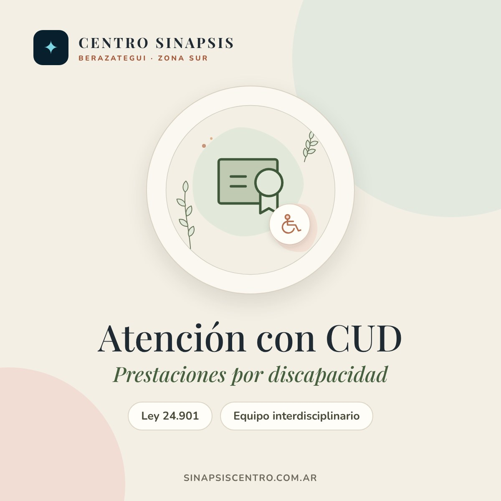

**Imagen:** `google-perfil/productos/03-discapacidad-cud.jpg`

**Nombre:**

```
Atención con CUD (discapacidad)
```

**Categoría:** Autismo y discapacidad

**Descripción:**

```
Centro interdisciplinario en Berazategui con prestaciones para personas con discapacidad de toda la Zona Sur: Quilmes, Florencio Varela, Avellaneda, Hudson y alrededores.

Acompañamos, entre otras situaciones, a personas con autismo (TEA), retrasos madurativos o del lenguaje, dificultades motoras, discapacidad intelectual, TDAH y adultos mayores que necesitan sostener su autonomía.

Prestaciones: psicología, psicopedagogía, fonoaudiología, terapia ocupacional, estimulación temprana, kinesiología y evaluaciones (ADOS-2 y ADI-R, neurocognitiva y psicodiagnóstico).

Con el Certificado Único de Discapacidad (CUD), las prestaciones de la Ley 24.901 están a cargo de la obra social o prepaga, según cada cobertura. Si todavía no tenés el CUD, te orientamos con el trámite, que es gratuito. Consultanos por WhatsApp.
```

**Botón:** Más información

**Enlace:**

```
https://sinapsiscentro.com.ar/centro-discapacidad-zona-sur.html?utm_source=google&utm_medium=organic&utm_campaign=gbp
```

---

## 4. Psicología para niños, adolescentes y adultos

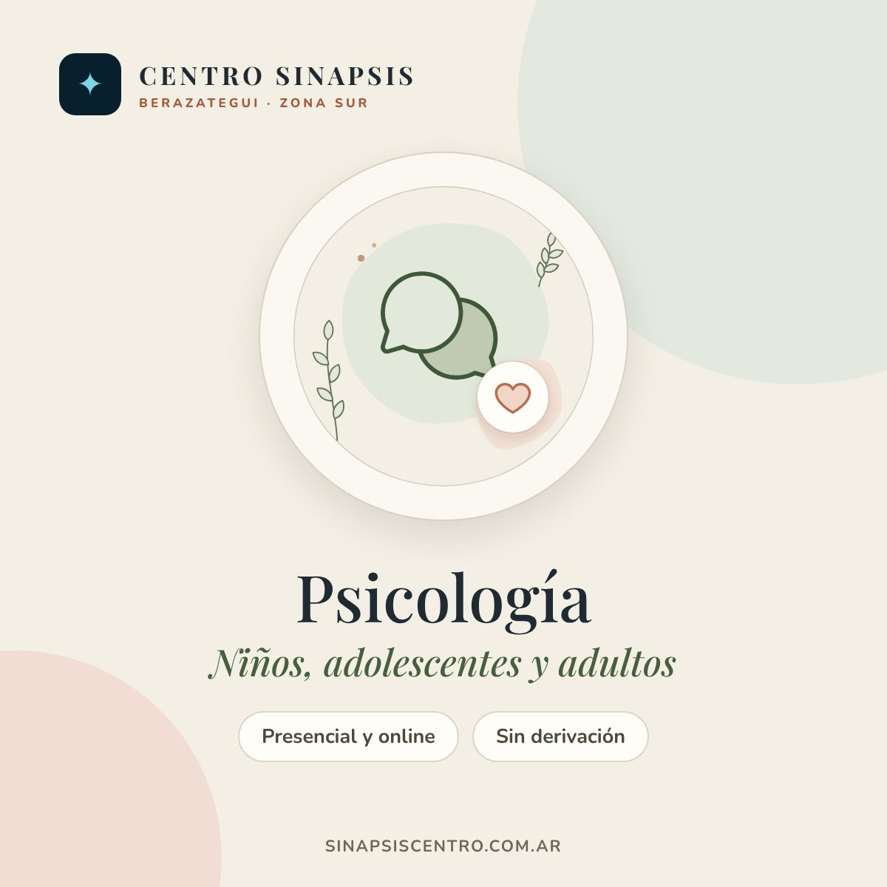

**Imagen:** `google-perfil/productos/04-psicologia.jpg`

**Nombre:**

```
Psicología para niños, adolescentes y adultos
```

**Categoría:** Terapias

**Descripción:**

```
Atención psicológica en Berazategui para niños, adolescentes y adultos, desde una escucha real y sin apuro. Cada proceso se arma a medida: no hay un protocolo único, sino un plan que se ajusta a la etapa de vida y a lo que cada persona necesita.

Consultas frecuentes: ansiedad, preocupaciones o ataques de pánico; tristeza que se prolonga o desgano; duelos, separaciones y cambios difíciles; conflictos en la familia, la pareja, la escuela o el trabajo.

En niños y adolescentes acompañamos el desarrollo, las emociones y la vida escolar, con participación de la familia. En adultos también acompañamos diagnósticos tardíos de TEA o TDAH.

Atención presencial y online. No hace falta derivación médica. Atendemos por reintegro con obras sociales y prepagas, y con CUD.
```

**Botón:** Más información

**Enlace:**

```
https://sinapsiscentro.com.ar/psicologia-berazategui.html?utm_source=google&utm_medium=organic&utm_campaign=gbp
```

---

## 5. Fonoaudiología: lenguaje, habla, voz y deglución

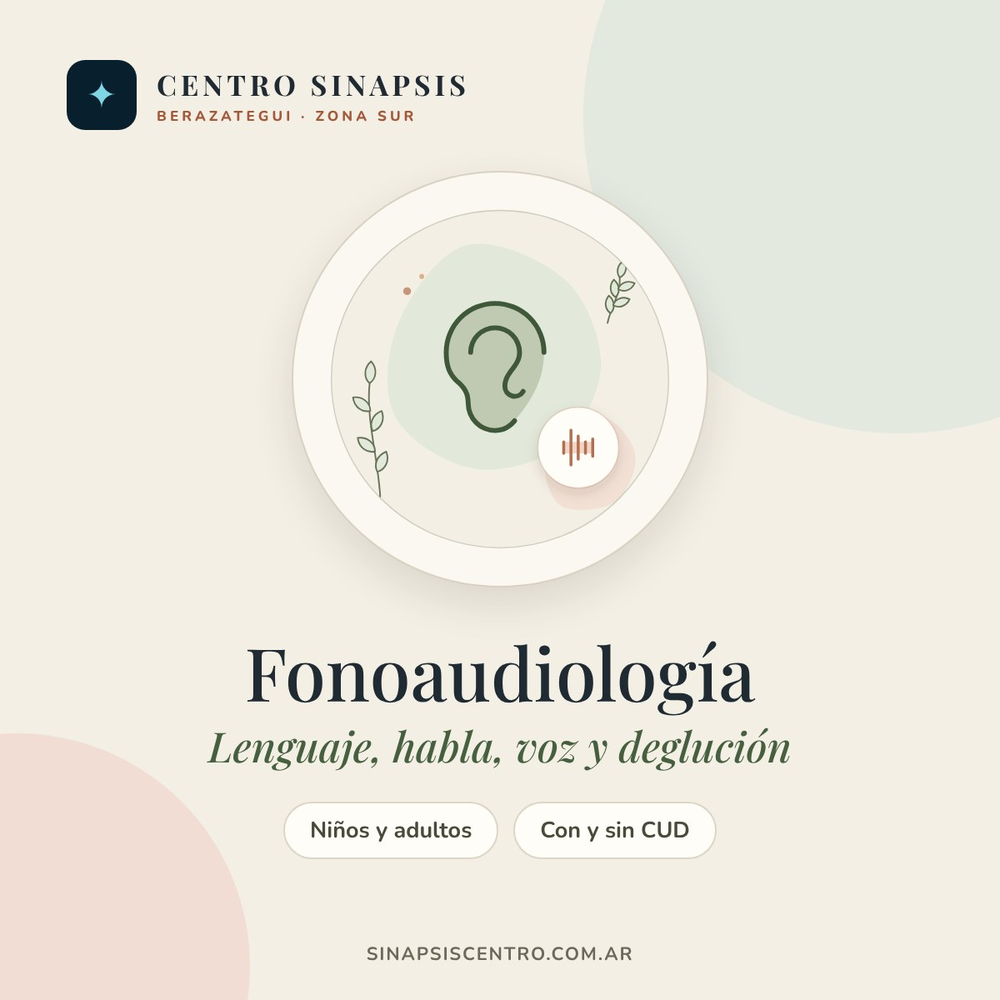

**Imagen:** `google-perfil/productos/05-fonoaudiologia.jpg`

**Nombre:**

```
Fonoaudiología: lenguaje, habla, voz y deglución
```

**Categoría:** Terapias

**Descripción:**

```
Fonoaudiología en Berazategui para el lenguaje, el habla, la voz y la deglución. El objetivo es que cada persona pueda comunicarse de la forma más funcional posible en su vida cotidiana, escolar o social.

Trabajamos con:
• niños que hablan poco o empezaron a hablar más tarde de lo esperado;
• dificultades para pronunciar algunos sonidos (dislalias) o para que se les entienda;
• Trastorno Específico del Lenguaje (TEL);
• sistemas de comunicación aumentativa o alternativa;
• cambios en la voz, cansancio vocal o dificultades para tragar.

No hace falta derivación médica. Atendemos con y sin CUD. Escribinos por WhatsApp y coordinamos la primera entrevista.
```

**Botón:** Más información

**Enlace:**

```
https://sinapsiscentro.com.ar/fonoaudiologia-berazategui.html?utm_source=google&utm_medium=organic&utm_campaign=gbp
```

---

## 6. Terapia ocupacional e integración sensorial

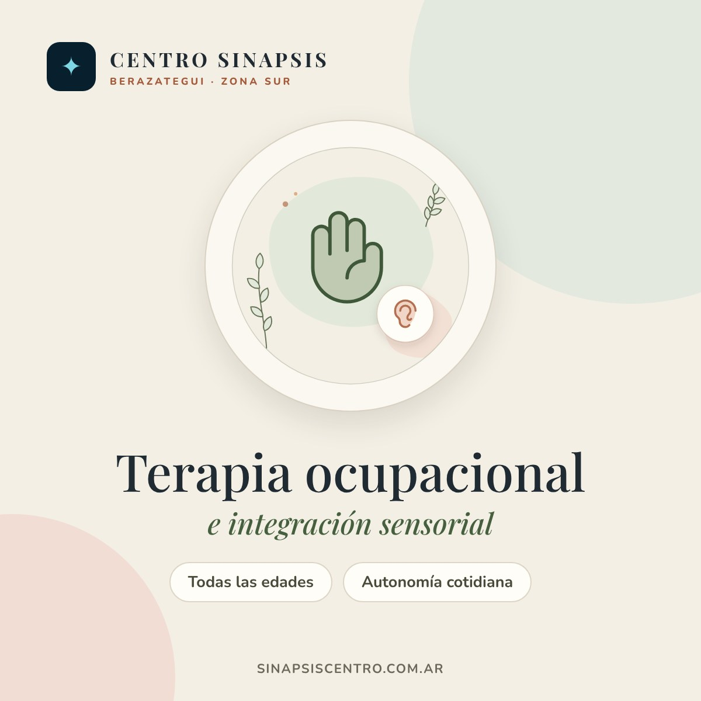

**Imagen:** `google-perfil/productos/06-terapia-ocupacional.jpg`

**Nombre:**

```
Terapia ocupacional e integración sensorial
```

**Categoría:** Terapias

**Descripción:**

```
Terapia ocupacional en Berazategui, con trabajo en integración sensorial (cómo el cuerpo procesa la información que recibe del entorno) y en las habilidades necesarias para la vida diaria.

Cuándo consultar:
• reacciones muy intensas a ruidos, texturas, luces o al contacto;
• búsqueda constante de movimiento, o rechazo a hamacas y toboganes;
• dificultades para vestirse, comer o higienizarse;
• motricidad fina: agarrar el lápiz, recortar, abrocharse.

Acompañamos en todas las edades, desde la estimulación temprana, adaptando los objetivos a lo que cada persona necesita para desenvolverse con más autonomía. Sin derivación médica, con y sin CUD.
```

**Botón:** Más información

**Enlace:**

```
https://sinapsiscentro.com.ar/terapia-ocupacional-integracion-sensorial.html?utm_source=google&utm_medium=organic&utm_campaign=gbp
```

---

## 7. Psicopedagogía: dificultades de aprendizaje

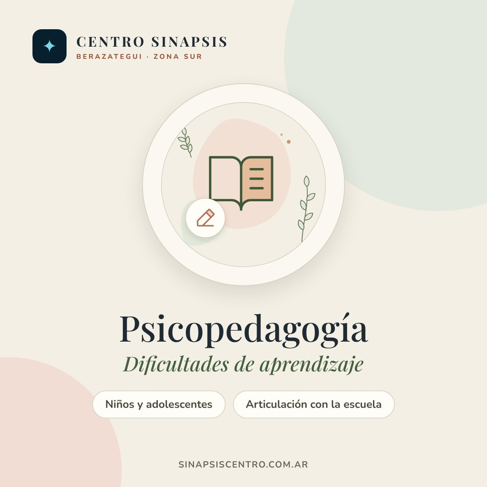

**Imagen:** `google-perfil/productos/07-psicopedagogia.jpg`

**Nombre:**

```
Psicopedagogía: dificultades de aprendizaje
```

**Categoría:** Terapias

**Descripción:**

```
Acompañamiento psicopedagógico en Berazategui para niños y adolescentes con dificultades de aprendizaje.

Cuándo consultar:
• dificultades con la lectura y la escritura;
• problemas con los números, el cálculo o la resolución de problemas;
• dificultades para sostener la atención, organizarse o terminar las tareas;
• bajo rendimiento escolar que preocupa a la familia o a la escuela;
• señales compatibles con dislexia, discalculia o disgrafía.

Cuando la dificultad está en la adquisición de la lectura y la escritura, el trabajo incluye alfabetización. Articulamos con el colegio cuando hace falta. Sin derivación médica, con y sin CUD.
```

**Botón:** Más información

**Enlace:**

```
https://sinapsiscentro.com.ar/psicopedagogia-dificultades-aprendizaje.html?utm_source=google&utm_medium=organic&utm_campaign=gbp
```

---

## 8. TDAH: evaluación y acompañamiento

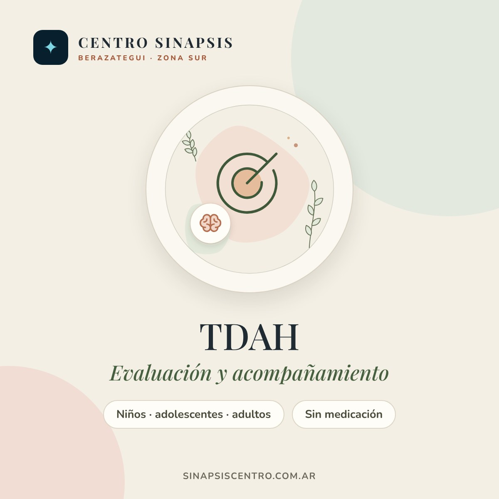

**Imagen:** `google-perfil/productos/08-tdah.jpg`

**Nombre:**

```
TDAH: evaluación y acompañamiento
```

**Categoría:** Evaluaciones

**Descripción:**

```
Evaluamos y acompañamos el TDAH (trastorno por déficit de atención e hiperactividad) en niños, adolescentes y adultos de Berazategui y la Zona Sur. El TDAH no es falta de voluntad ni mala conducta: es una forma distinta de funcionamiento de la atención, la organización y el control de los impulsos.

Evaluación: evaluación neurocognitiva (atención, memoria y funciones ejecutivas) y psicodiagnóstico, con entrevistas a la familia y, si hace falta, información de la escuela.

Acompañamiento: psicología (regulación, frustración e impulsividad), psicopedagogía (organización y técnicas de estudio) y orientación a la familia y la escuela.

Muchos adultos consultan después del diagnóstico de un hijo. El centro no receta medicación. Coordinamos por WhatsApp.
```

**Botón:** Más información

**Enlace:**

```
https://sinapsiscentro.com.ar/tdah-berazategui.html?utm_source=google&utm_medium=organic&utm_campaign=gbp
```

---

## 9. Kinesiología para adultos mayores

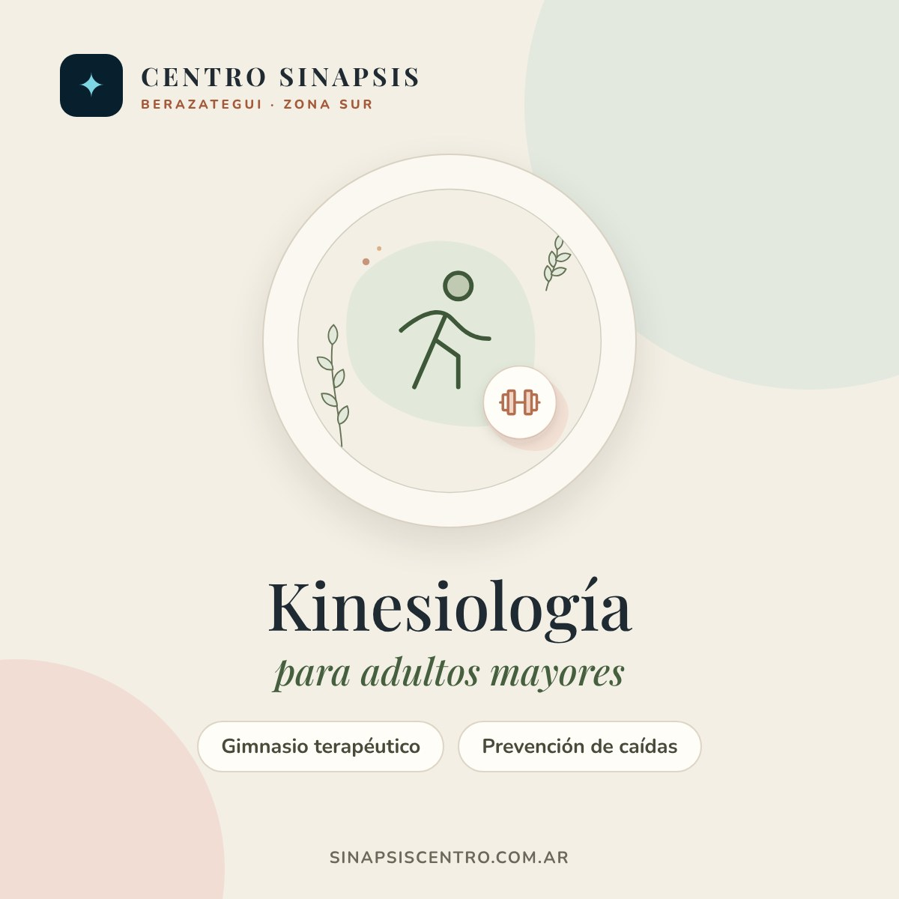

**Imagen:** `google-perfil/productos/09-kinesiologia.jpg`

**Nombre:**

```
Kinesiología para adultos mayores
```

**Categoría:** Adultos mayores

**Descripción:**

```
Gimnasio terapéutico de kinesiología para adultos mayores en Berazategui, centrado en el movimiento, la prevención y el mantenimiento de la autonomía.

Cómo trabajamos:
• antes de empezar, el kinesiólogo conoce tu estado de salud, tus antecedentes y tus objetivos;
• se trabaja fuerza, equilibrio y movilidad, siempre dentro de tus posibilidades y con progresión gradual;
• el plan se revisa con el tiempo para ajustarlo a cómo te vas sintiendo.

Para quienes buscan una actividad física guiada y segura, quieren prevenir caídas o necesitan sostener el ejercicio después de una indicación médica. Escribinos por WhatsApp.
```

**Botón:** Más información

**Enlace:**

```
https://sinapsiscentro.com.ar/kinesiologia-adultos-mayores-berazategui.html?utm_source=google&utm_medium=organic&utm_campaign=gbp
```

---

## 10. Aptos psicológicos y psicotécnicos

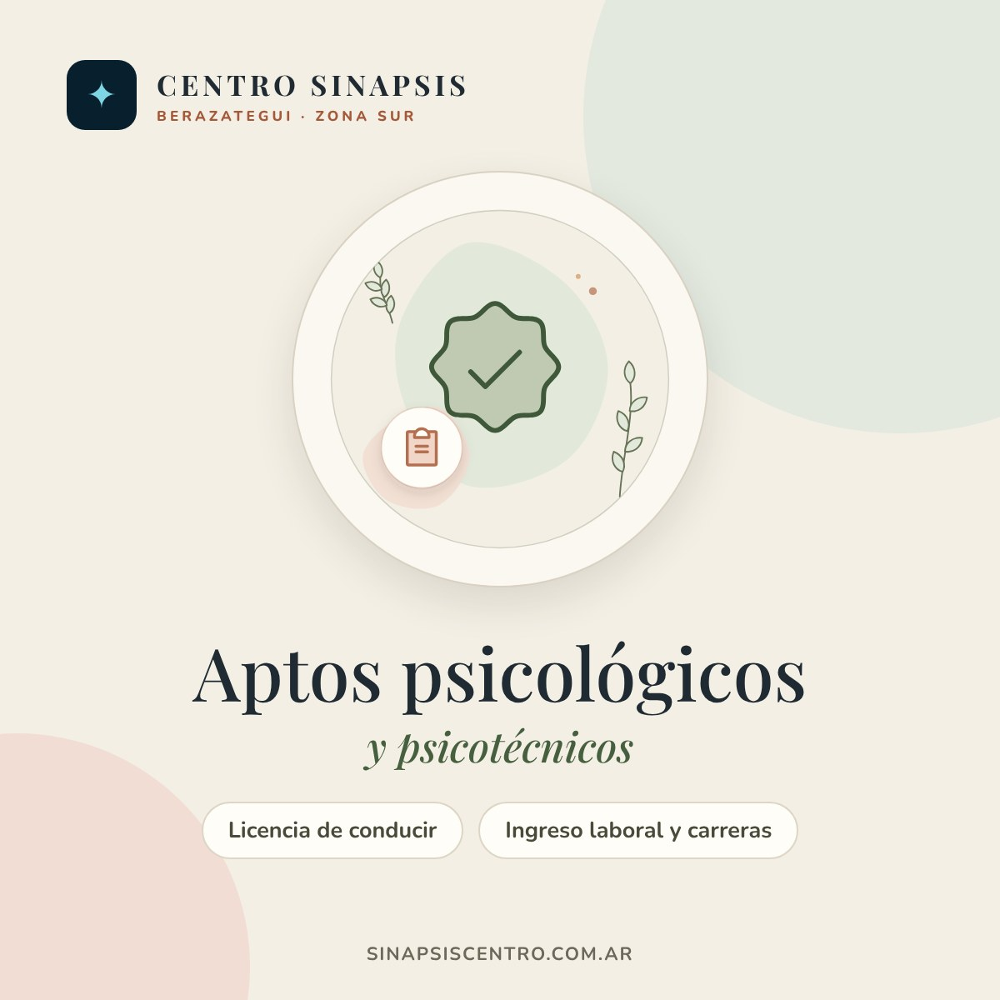

**Imagen:** `google-perfil/productos/10-aptos-psicologicos.jpg`

**Nombre:**

```
Aptos psicológicos y psicotécnicos
```

**Categoría:** Evaluaciones

**Descripción:**

```
Evaluación psicológica breve para un trámite concreto, en nuestra sede de Berazategui:
• licencia de conducir, cuando el trámite pide un informe psicológico;
• exámenes psicotécnicos de ingreso laboral o preocupacionales;
• carreras, profesorados e institutos que piden un apto para la inscripción.

Incluye una conversación breve y pruebas elegidas según el trámite (atención, razonamiento y técnicas psicológicas habituales). El profesional redacta el informe con su firma y matrícula; el plazo de entrega se acuerda al pedir el turno.

No es un tratamiento ni un psicodiagnóstico completo. Turno por WhatsApp.
```

**Botón:** Más información

**Enlace:**

```
https://sinapsiscentro.com.ar/aptos-psicologicos-psicotecnicos-berazategui.html?utm_source=google&utm_medium=organic&utm_campaign=gbp
```

---

## 11. Talleres: alfabetización, cognición y habilidades sociales

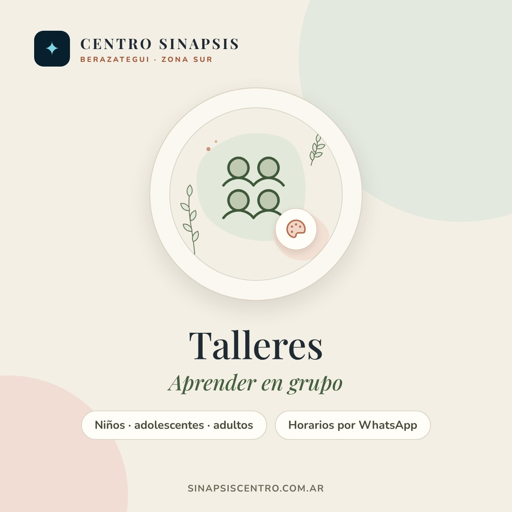

**Imagen:** `google-perfil/productos/11-talleres.jpg`

**Nombre:**

```
Talleres: alfabetización, cognición y habilidades sociales
```

**Categoría:** Talleres

**Descripción:**

```
Espacios grupales de aprendizaje y desarrollo de habilidades en Centro Sinapsis, Berazategui:

• Taller de Alfabetización: lectura y escritura para niños y niñas.
• Estimulación Cognitiva para Niños: atención, memoria, lenguaje y razonamiento a través del juego.
• Estimulación Cognitiva para Adultos: memoria, atención, planificación y agilidad mental, para adultos y adultos mayores.
• Taller de Habilidades Sociales: comunicación, emociones, empatía y vínculos, para niños, niñas y adolescentes.

Los talleres no son tratamientos. Consultá días, horarios y grupos por WhatsApp.
```

**Botón:** Más información

**Enlace:**

```
https://sinapsiscentro.com.ar/talleres.html?utm_source=google&utm_medium=organic&utm_campaign=gbp
```

---

## Para cambiar textos o imágenes

Los datos están en `google-perfil/productos.json`. Las imágenes se regeneran con:

```bash
node scripts/generar_productos_google.js
```

---

## Productos de la categoría Psicología (enfoques)

Cada orientación tiene su propia página. Usá estos enlaces en el botón **Más información**:

| Producto | Enlace |
|---|---|
| Psicoanálisis | `https://sinapsiscentro.com.ar/psicoanalisis-berazategui.html?utm_source=google&utm_medium=organic&utm_campaign=gbp` |
| Terapia Gestalt | `https://sinapsiscentro.com.ar/terapia-gestalt-berazategui.html?utm_source=google&utm_medium=organic&utm_campaign=gbp` |
| Terapia Cognitivo Conductual | `https://sinapsiscentro.com.ar/terapia-cognitivo-conductual-berazategui.html?utm_source=google&utm_medium=organic&utm_campaign=gbp` |
| Terapia Sistémica | `https://sinapsiscentro.com.ar/terapia-sistemica-familiar-berazategui.html?utm_source=google&utm_medium=organic&utm_campaign=gbp` |
| Terapia Junguiana | `https://sinapsiscentro.com.ar/terapia-junguiana-berazategui.html?utm_source=google&utm_medium=organic&utm_campaign=gbp` |
