# Publicaciones para la ficha de Google

**Ritmo recomendado:** una por semana (o dos, si se puede sostener). Mejor constante que muchas juntas.

**Cómo publicar:** ficha → **Agregar novedad** → subí la imagen → pegá el texto → botón **Más información** → pegá el enlace → **Publicar**.

Carruseles hechos antes (publicar primero): `senales-autismo/` (5 imágenes, enlace a senales-autismo-ninos.html) y `cud/` (5 imágenes, enlace a centro-discapacidad-zona-sur.html).

---

## Publicación 1: Fonoaudiología

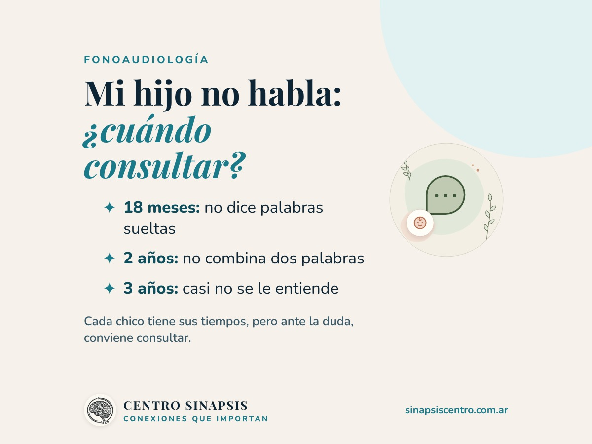

**Imagen:** `google-perfil/publicaciones/01-lenguaje.jpg`

**Texto:**

```
Mi hijo no habla todavía: ¿cuándo consultar? Cada chico tiene sus tiempos, pero hay señales por edad que conviene no dejar pasar: a los 18 meses, no decir palabras sueltas; a los 2 años, no combinar dos palabras; a los 3, que casi no se le entienda. En Centro Sinapsis evaluamos el lenguaje infantil en Berazategui, sin derivación médica.
```

**Botón:** Más información

**Enlace:**

```
https://sinapsiscentro.com.ar/retraso-lenguaje-ninos.html?utm_source=google&utm_medium=organic&utm_campaign=gbp_post
```

---

## Publicación 2: Atención · TDAH

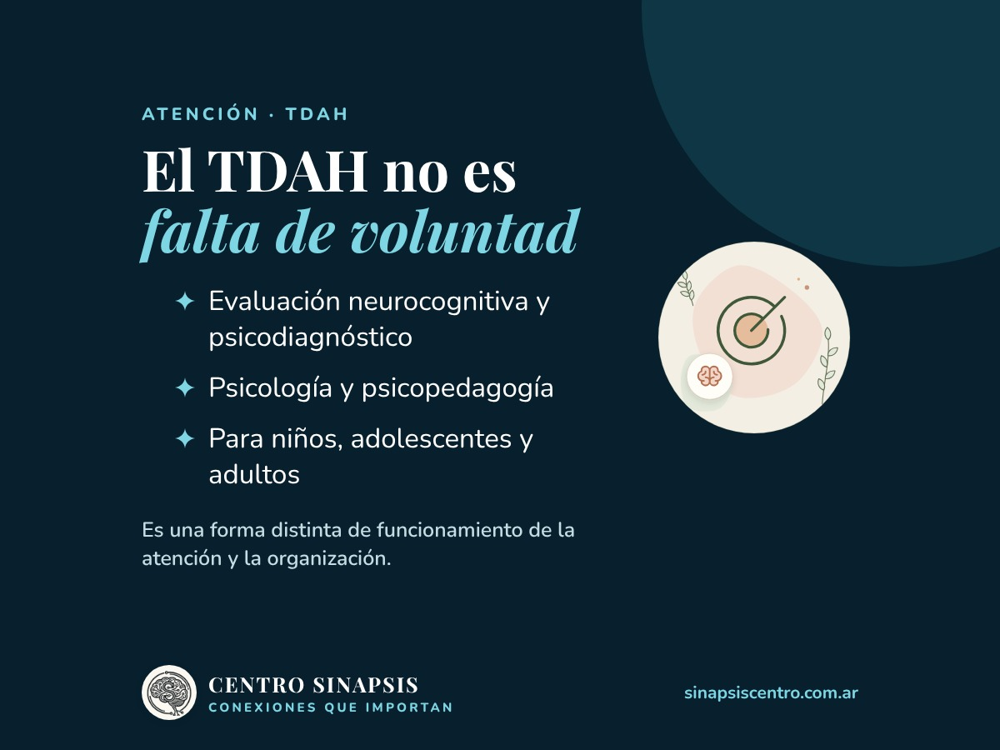

**Imagen:** `google-perfil/publicaciones/02-tdah.jpg`

**Texto:**

```
El TDAH no es falta de voluntad ni mala conducta: es una forma distinta de funcionamiento de la atención, la organización y el control de los impulsos. En Centro Sinapsis lo evaluamos y acompañamos en niños, adolescentes y adultos, con evaluación neurocognitiva, psicodiagnóstico, psicología y psicopedagogía. El centro no receta medicación.
```

**Botón:** Más información

**Enlace:**

```
https://sinapsiscentro.com.ar/tdah-berazategui.html?utm_source=google&utm_medium=organic&utm_campaign=gbp_post
```

---

## Publicación 3: Adultos mayores

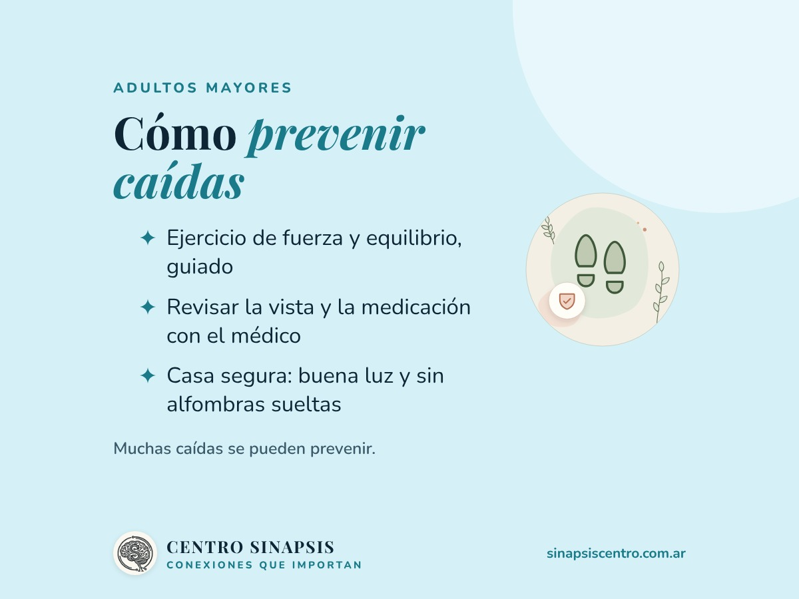

**Imagen:** `google-perfil/publicaciones/03-caidas.jpg`

**Texto:**

```
Las caídas son una de las principales causas de lesiones en personas mayores, pero muchas se pueden prevenir. Lo que más ayuda es el ejercicio de fuerza y equilibrio, revisar la vista y la medicación con el médico, y adaptar la casa. En nuestro gimnasio terapéutico de kinesiología trabajamos fuerza, equilibrio y autonomía.
```

**Botón:** Más información

**Enlace:**

```
https://sinapsiscentro.com.ar/prevencion-caidas-adultos-mayores.html?utm_source=google&utm_medium=organic&utm_campaign=gbp_post
```

---

## Publicación 4: Evaluaciones

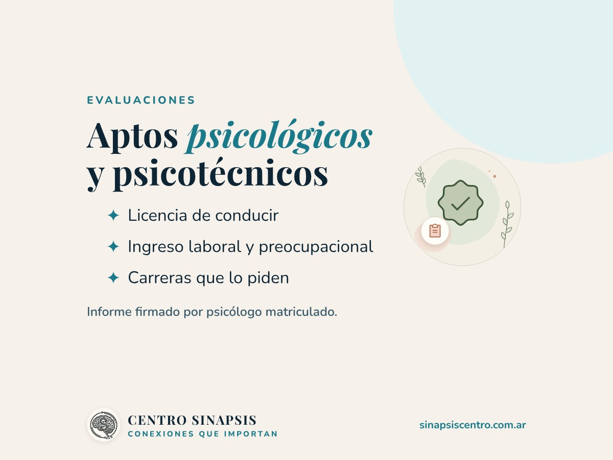

**Imagen:** `google-perfil/publicaciones/04-aptos.jpg`

**Texto:**

```
¿Necesitás un apto psicológico? Hacemos evaluaciones psicotécnicas para la licencia de conducir, el ingreso laboral y las carreras que lo piden, con informe firmado por psicólogo matriculado. Antes de sacar turno, confirmá qué tipo de informe te piden. Turnos por WhatsApp, en Berazategui.
```

**Botón:** Más información

**Enlace:**

```
https://sinapsiscentro.com.ar/aptos-psicologicos-psicotecnicos-berazategui.html?utm_source=google&utm_medium=organic&utm_campaign=gbp_post
```

---

## Publicación 5: Psicología

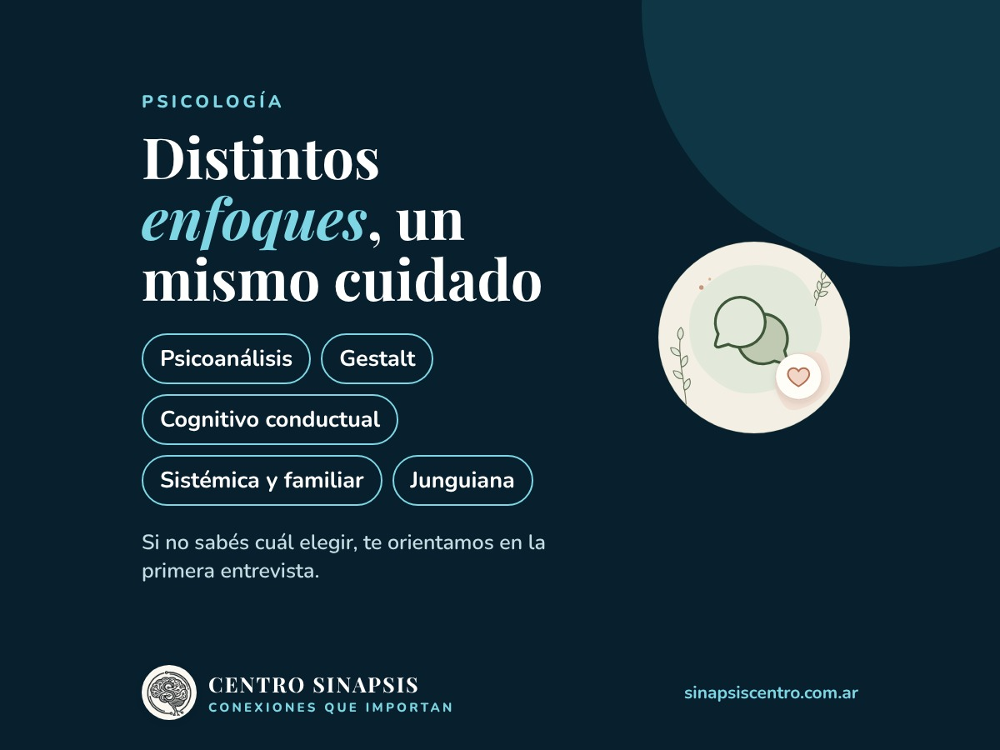

**Imagen:** `google-perfil/publicaciones/05-enfoques.jpg`

**Texto:**

```
En Centro Sinapsis el equipo de psicología trabaja desde distintos enfoques: psicoanálisis, terapia Gestalt, cognitivo conductual (TCC), sistémica y familiar, y junguiana. Si ya sabés cuál preferís, contanos; si no, te orientamos en la primera entrevista. Conocé cada enfoque en nuestra web.
```

**Botón:** Más información

**Enlace:**

```
https://sinapsiscentro.com.ar/psicologia-berazategui.html?utm_source=google&utm_medium=organic&utm_campaign=gbp_post#enfoques
```

---

## Publicación 6: Psicopedagogía

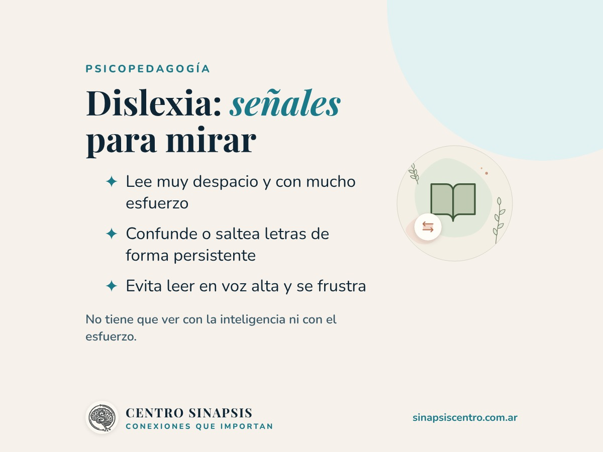

**Imagen:** `google-perfil/publicaciones/06-dislexia.jpg`

**Texto:**

```
La dislexia es una dificultad específica para aprender a leer con fluidez, que no tiene que ver con la inteligencia ni con el esfuerzo. Si tu hijo lee mucho más lento que sus compañeros, confunde o saltea letras de forma persistente o sufre cada vez que tiene que leer, conviene consultar. La psicopedagogía evalúa y acompaña.
```

**Botón:** Más información

**Enlace:**

```
https://sinapsiscentro.com.ar/dislexia-senales-ninos.html?utm_source=google&utm_medium=organic&utm_campaign=gbp_post
```

---

## Publicación 7: Psicología infantil

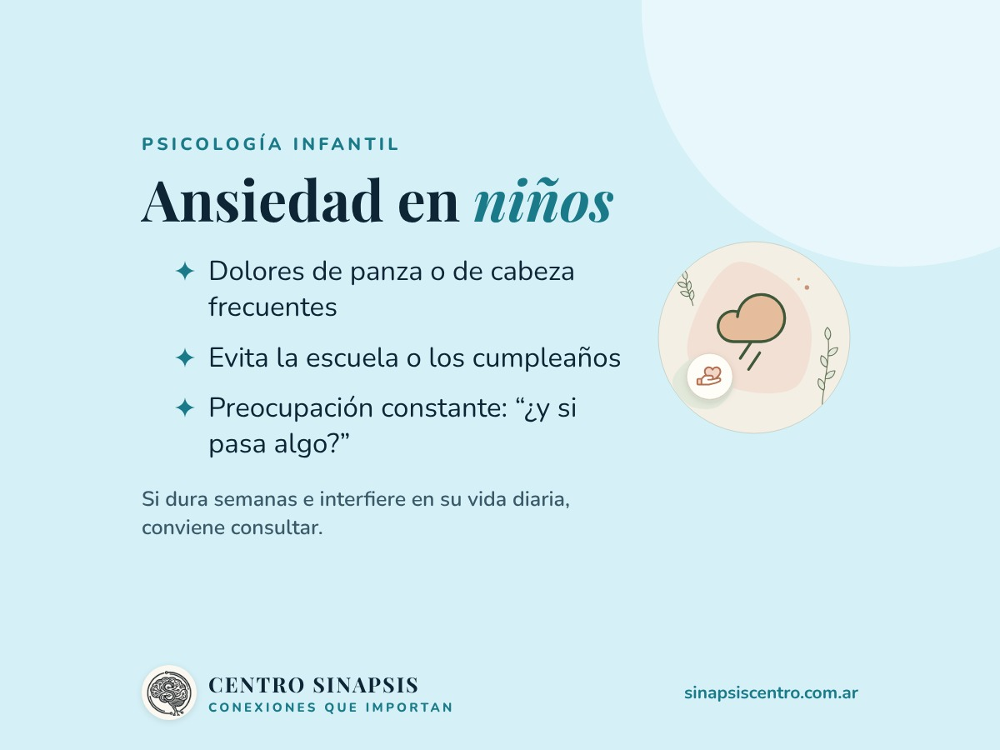

**Imagen:** `google-perfil/publicaciones/07-ansiedad.jpg`

**Texto:**

```
Sentir miedo o preocupación es normal en la infancia. La ansiedad se vuelve un problema cuando es muy intensa, dura semanas e interfiere en la vida diaria: dolores de panza o de cabeza frecuentes, evitar la escuela, preocupación constante. En Centro Sinapsis acompañamos a niños, adolescentes y sus familias, sin derivación médica.
```

**Botón:** Más información

**Enlace:**

```
https://sinapsiscentro.com.ar/ansiedad-en-ninos.html?utm_source=google&utm_medium=organic&utm_campaign=gbp_post
```

---

## Publicación 8: Talleres

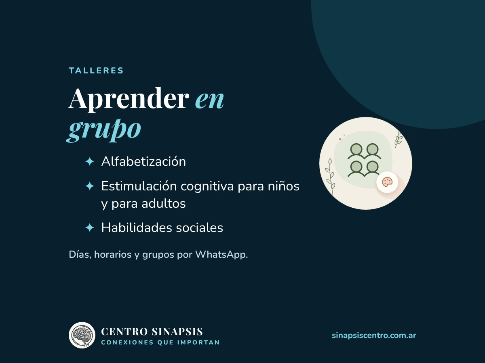

**Imagen:** `google-perfil/publicaciones/08-talleres.jpg`

**Texto:**

```
Talleres en Centro Sinapsis, Berazategui: alfabetización, estimulación cognitiva para niños y para adultos, y habilidades sociales para niños, niñas y adolescentes. Son espacios grupales de aprendizaje, no tratamientos. Consultá días, horarios y grupos por WhatsApp.
```

**Botón:** Más información

**Enlace:**

```
https://sinapsiscentro.com.ar/talleres.html?utm_source=google&utm_medium=organic&utm_campaign=gbp_post
```

---

## Publicación 9: Estimulación temprana

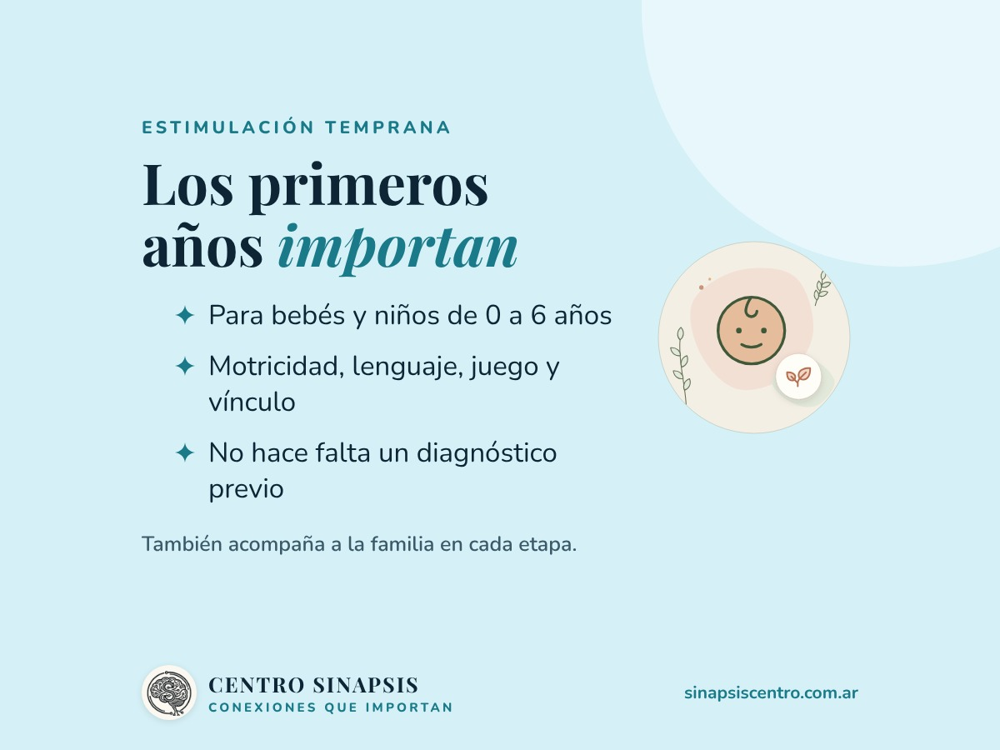

**Imagen:** `google-perfil/publicaciones/09-estimulacion-temprana.jpg`

**Texto:**

```
Los primeros años de vida son una etapa en la que el cerebro tiene una capacidad de desarrollo particularmente alta. La estimulación temprana acompaña a bebés y niños de 0 a 6 años en lo motor, el lenguaje, lo cognitivo y lo social. No hace falta un diagnóstico previo: sirve como prevención y como apoyo cuando hay una alerta o una demora.
```

**Botón:** Más información

**Enlace:**

```
https://sinapsiscentro.com.ar/estimulacion-temprana-berazategui.html?utm_source=google&utm_medium=organic&utm_campaign=gbp_post
```

---

## Publicación 10: Terapia ocupacional

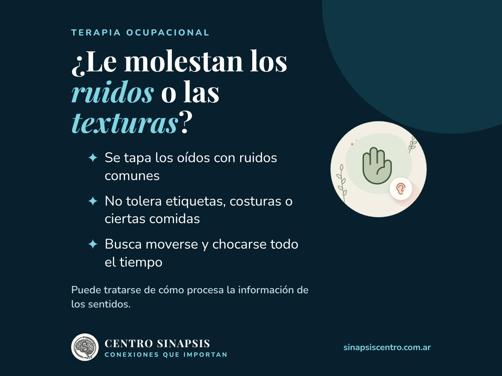

**Imagen:** `google-perfil/publicaciones/10-integracion-sensorial.jpg`

**Texto:**

```
Algunos chicos reaccionan de más o de menos a lo que les llega por los sentidos: se tapan los oídos con ruidos comunes, no toleran ciertas ropas o comidas, o buscan moverse y chocarse todo el tiempo. Cuando eso dificulta su día a día, la terapia ocupacional con enfoque en integración sensorial puede evaluar y acompañar. Sin derivación médica.
```

**Botón:** Más información

**Enlace:**

```
https://sinapsiscentro.com.ar/integracion-sensorial-senales.html?utm_source=google&utm_medium=organic&utm_campaign=gbp_post
```

---

## Publicación 11: Fonoaudiología

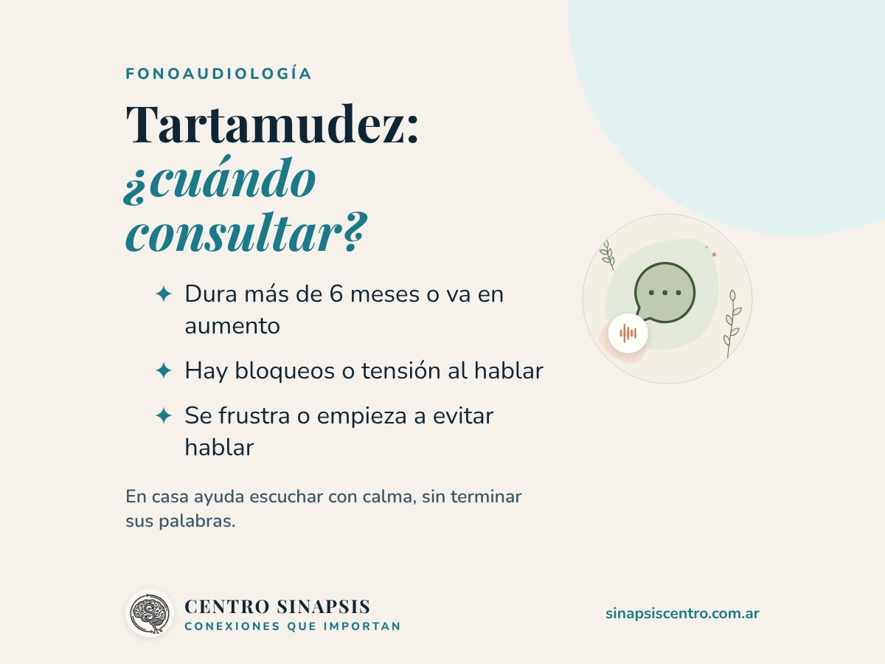

**Imagen:** `google-perfil/publicaciones/11-tartamudez.jpg`

**Texto:**

```
Entre los 2 y los 5 años muchos chicos repiten sílabas mientras aprenden a hablar, y muchas veces se resuelve sola. Conviene consultar con fonoaudiología si dura más de 6 meses, si hay bloqueos o tensión al hablar, si el chico se frustra o evita hablar, o si empezó después de los 3 años y medio. Lo que más ayuda en casa: tiempo y calma.
```

**Botón:** Más información

**Enlace:**

```
https://sinapsiscentro.com.ar/tartamudez-ninos.html?utm_source=google&utm_medium=organic&utm_campaign=gbp_post
```

---

## Publicación 12: Adultos mayores

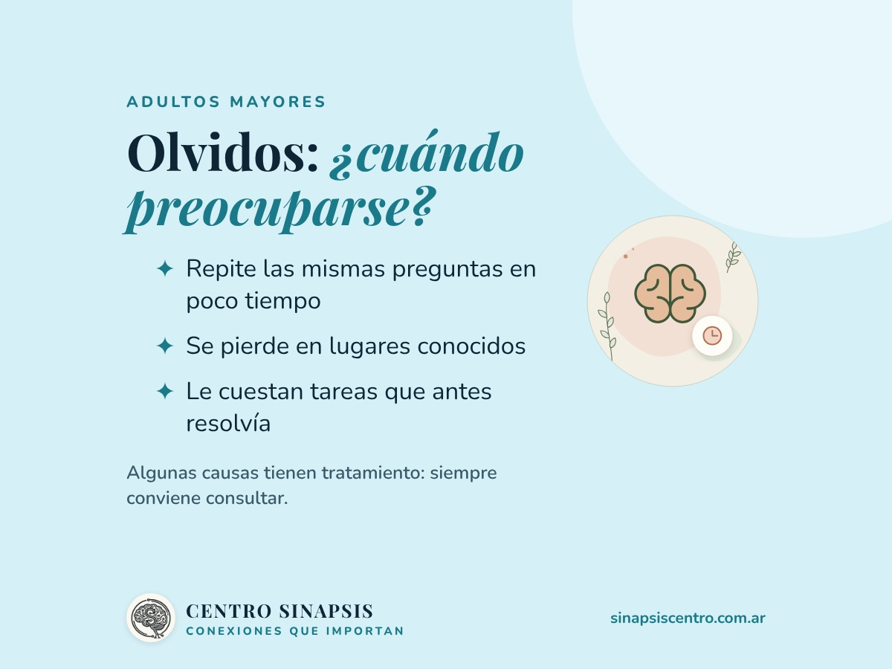

**Imagen:** `google-perfil/publicaciones/12-olvidos.jpg`

**Texto:**

```
Con los años es esperable tardar más en recordar un nombre. Conviene consultar cuando los olvidos son frecuentes y afectan la vida diaria: repetir las mismas preguntas, perderse en lugares conocidos, o no poder con tareas que antes resolvía. Hacemos evaluación neurocognitiva y estimulación cognitiva, junto al médico de cabecera.
```

**Botón:** Más información

**Enlace:**

```
https://sinapsiscentro.com.ar/olvidos-memoria-adultos-mayores.html?utm_source=google&utm_medium=organic&utm_campaign=gbp_post
```

---

## Publicación 13: Psicología

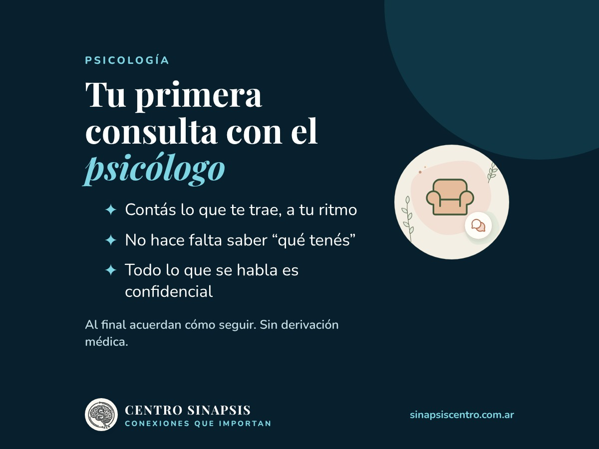

**Imagen:** `google-perfil/publicaciones/13-primera-consulta.jpg`

**Texto:**

```
La primera consulta con un psicólogo es una charla para conocerse: contás qué te trae y qué te gustaría que cambie, a tu ritmo. No hace falta tener todo claro ni saber “qué tenés”, y todo lo que se habla es confidencial. Al final acuerdan cómo seguir. En Centro Sinapsis podés pedir tu primera entrevista por WhatsApp, sin derivación médica.
```

**Botón:** Más información

**Enlace:**

```
https://sinapsiscentro.com.ar/primera-consulta-psicologo.html?utm_source=google&utm_medium=organic&utm_campaign=gbp_post
```

---

## Publicación 14: Orientación vocacional

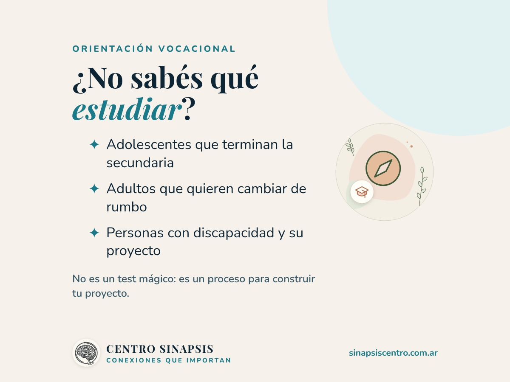

**Imagen:** `google-perfil/publicaciones/14-orientacion-vocacional.jpg`

**Texto:**

```
La orientación vocacional y ocupacional no es un test que da una respuesta mágica: es un proceso para conocerte mejor, explorar opciones reales y construir un proyecto propio. Para adolescentes que terminan la secundaria, adultos que quieren cambiar de rumbo y personas con discapacidad que buscan un proyecto de formación o de trabajo.
```

**Botón:** Más información

**Enlace:**

```
https://sinapsiscentro.com.ar/orientacion-vocacional-ocupacional-berazategui.html?utm_source=google&utm_medium=organic&utm_campaign=gbp_post
```

---

## Publicación 15: Crianza

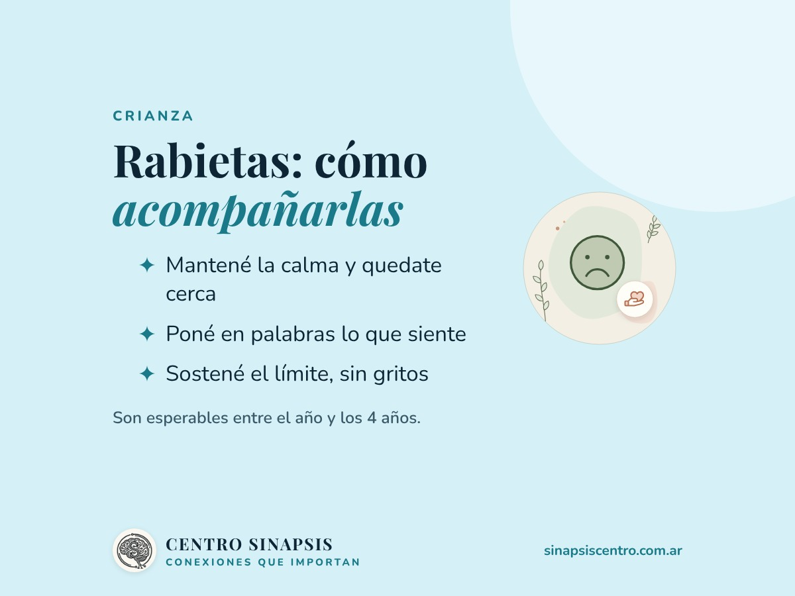

**Imagen:** `google-perfil/publicaciones/15-rabietas.jpg`

**Texto:**

```
Las rabietas son esperables entre el año y los 4 años: el chico siente emociones muy intensas y todavía no tiene herramientas para manejarlas. Ayuda mantener la calma, poner en palabras lo que siente y sostener el límite sin gritos. Conviene consultar si son diarias, muy largas, siguen intensas después de los 5 años o incluyen golpes.
```

**Botón:** Más información

**Enlace:**

```
https://sinapsiscentro.com.ar/rabietas-berrinches-ninos.html?utm_source=google&utm_medium=organic&utm_campaign=gbp_post
```

---

## Publicación 16: Terapia ocupacional

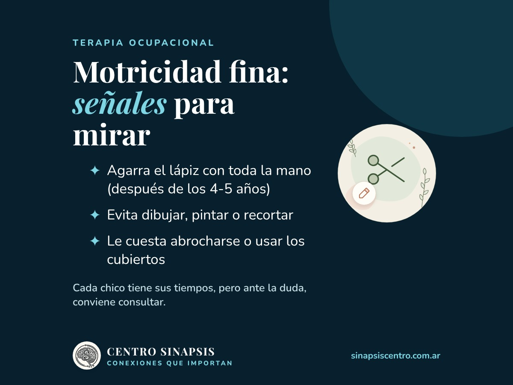

**Imagen:** `google-perfil/publicaciones/16-motricidad-fina.jpg`

**Texto:**

```
La motricidad fina son los movimientos precisos de manos y dedos: agarrar el lápiz, recortar, abrocharse, usar los cubiertos. Si a tu hijo le cuestan mucho estas actividades para su edad, evita dibujar o se frustra con las tareas manuales, conviene consultar con terapia ocupacional. En Centro Sinapsis la evaluamos sin derivación médica.
```

**Botón:** Más información

**Enlace:**

```
https://sinapsiscentro.com.ar/motricidad-fina-ninos.html?utm_source=google&utm_medium=organic&utm_campaign=gbp_post
```

---

Las imágenes se regeneran con `node scripts/generar_publicaciones_google.js` (textos en `publicaciones.json`).
